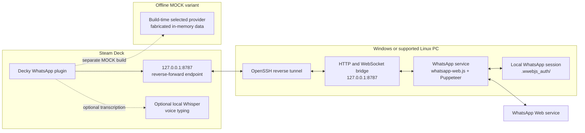

# Architecture

The Deck plugin talks to the PC bridge through an SSH reverse tunnel. Both
bridge and tunnel are started deliberately by the user. The bridge listens on
PC loopback by default; it is not intended to be exposed to a LAN.

The bridge exposes authenticated HTTP operations and a WebSocket event stream.
It generates a process-local token and delivers it to the plugin through the
Deck origin bootstrap endpoint. Message, chat, media, reaction, and status data
flow between the plugin and the local `WhatsAppService`. WhatsApp Web runs in a
headless browser on the PC; the plugin does not embed the browser or WhatsApp
session.

The MOCK plugin selects its offline provider at build time. Its fabricated
state stays in memory and does not use the production bridge, WhatsApp Web,
session files, or production credentials. Its tests and install procedure are
documented separately from the production companion workflow.
